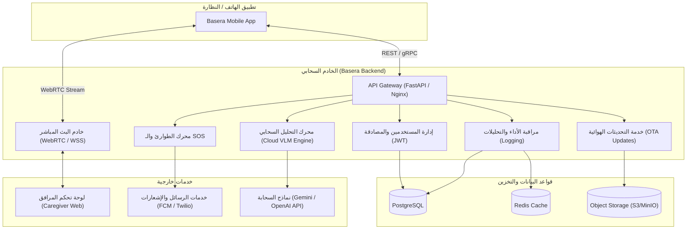

# وثيقة المتطلبات والمعمارية الهندسية للباك إند (Backend Architecture & Specifications)
## مشروع بصيرة (Basera) — النظارات الذكية لمساعدة فاقدي البصر

---

## 1. نظرة عامة على دور الباك إند (Overview)

يعتمد مشروع **Basera** على معمارية هجينة **(Hybrid Edge-Cloud Architecture)**:
* **على حافة الجهاز (On-Device / Mobile Edge):** يعتمد على الموديل المحلي الخفيف `SmolVLM2-500M` لتوليد استجابات فورية وسريعة للعوائق الحركية والدرج والأبواب دون الحاجة للإنترنت.
* **على الخادم (Cloud Backend):** يتدخل لتوفير الإمكانيات المتقدمة التي تتطلب سعة حسابية عالية، والتواصل مع العالم الخارجي، وتأمين سلامة المستخدم الكفيف.

---

## 2. المحاور والمسؤوليات الأساسية للباك إند (Core Backend Modules)

---

### المحور الأول: خادم الذكاء الاصطناعي السحابي (Cloud VLM & Fallback API)
* **الهدف:** توفير استجابة فائقة الذكاء عندما يطلب المستخدم مهمة معقدة تفوق قدرة الموديل المحلي.
* **حالات الاستخدام:**
  * قراءة المستندات الطويلة والخطابات وقوائم الطعام (Dense OCR).
  * التعرف الدقيق على العملات النقدية وقيمتها.
  * قراءة تفاصيل العبوات وتاريخ انتهاء الصلاحية للمنتجات والأدوية.
* **المواصفات التقنية:**
  * نقطة نهاية (Endpoint) سريعة تستقبل الصورة مع السؤال الصوتي/النصي.
  * التكامل مع نماذج رؤية سحابية متقدمة (مثل: Gemini 1.5 Flash / GPT-4o-mini).
  * زمن استجابة مستهدف أقل من **1.5 ثانية**.

---

### المحور الثاني: البث المباشر والمساعدة البشرية عن بُعد (Live Streaming & Caregiver Support)
* **الهدف:** تمكين المرافق أو المتطوع (مثل فكرة *Be My Eyes*) من رؤية ما تراه كاميرا النظارة في الوقت الفعلي لمساعدة الكفيف.
* **المواصفات التقنية:**
  * خادم وسائط متدني التأخير **(Ultra-low latency)** يعتمد بروتوكول **WebRTC** أو **WebSockets**.
  * قناة صوتية ثنائية الاتجاه (Two-way audio) ليتحدث المرافق مع مرتدي النظارة مباشرة.
  * لوحة تحكم ويب خفيفة ومؤمنة للمرافقين (Web Dashboard).

---

### المحور الثالث: نظام الطوارئ والاستغاثة (SOS & Alert Dispatcher)
* **الهدف:** الحفاظ على سلامة المستخدم في المواقف الخطرة.
* **المواصفات التقنية:**
  * استقبال إشارة الاستغاثة (عبر ضغط زر معين في النظارة أو رصد سقوط مفاجئ عبر مستشعرات الحركة).
  * جمع: إحداثيات الموقع الحالي (GPS) + أحدث صورة التقطتها الكاميرا + تسجيل صوتي لـ 5 ثوانٍ.
  * إرسال فوري لإشعارات الهواتف (Push Notifications عبر Firebase FCM) ورسائل SMS عبر موفري الخدمة (Twilio / SMS Gateway) لقائمة أرقام الطوارئ المعتمدة.

---

### المحور الرابع: إدارة الحسابات وضبط النظارة (User Profile & Configuration)
* **الهدف:** حفظ التفضيلات الشخصية الخاصة بالكفيف لمزامنتها عند تغيير الهاتف.
* **البيانات المخزنة:**
  * لغة الصوت المفضلة (عربي، إنجليزي).
  * سرعة النطق (Speech Rate) ونبرة الصوت.
  * حساسية كاشف التغير الإدراكي (Change Detection Threshold).
  * أرقام وبيانات المرافقين وحالات الطوارئ.

---

### المحور الخامس: تحديث النماذج والبيانات هوائياً (OTA Model Delivery)
* **الهدف:** تحديث أوزان الموديل ومحركات الترجمة دون إجبار المستخدم على تنزيل تحديث جديد للتطبيق من المتجر.
* **المواصفات التقنية:**
  * استضافة أوزان الموديل المضغوطة (`.litertlm` أو `.onnx`) على خوادم تخزين سحابية (S3 / Cloud Storage).
  * API للتحقق من وجود إصدارات أحدث وتنزيل التحديثات في الخلفية مع دعم الاستئناف (Chunked / Resumable Downloads).

---

### المحور السادس: سجلات الأداء والتحليلات (Telemetry & Monitoring)
* **الهدف:** تتبع جودة التجربة وتحسين زمن الاستجابة في العالم الحقيقي.
* **البيانات المستلمة مجهولة الهوية:**
  * زمن استجابة كل عملية (Latency breakdown: Capture, Model, TTS).
  * نسبة تخطي المشاهد الثابتة (Change Detection Skip Ratio).
  * تقارير الأعطال والأخطاء غير المتوقعة (Crash Reporting).

---

## 3. مواصفات نقاط النهاية المقترحة (API Endpoints Specification)

| المسار (Route) | الطريقة (Method) | الوظيفة |
|---|---|---|
| `/api/v1/auth/login` | `POST` | تسجيل الدخول وتوليد التوكن (JWT). |
| `/api/v1/user/settings` | `GET / PUT` | جلب أو تحديث إعدادات وسرعة صوت النظارة. |
| `/api/v1/vision/describe-dense` | `POST` | إرسال صورة لتحليلها السحابي المفصل (OCR / فحص دقيق). |
| `/api/v1/emergency/sos` | `POST` | إطلاق حالة الطوارئ وإرسال الموقع والصورة لجهات الاتصال. |
| `/api/v1/models/latest` | `GET` | فحص وجود تحديث جديد لأوزان الذكاء الاصطناعي. |
| `/api/v1/telemetry/log` | `POST` | إرسال إحصائيات زمن المعالجة واستهلاك البطارية. |
| `/ws/stream/{session_id}` | `WebSocket` | قناة البث المباشر بين النظارة والمرافق. |

---

## 4. المكدس التقني الموصى به (Recommended Tech Stack)

* **لغة البرمجة وإطار العمل الأساسي:** **Python (FastAPI)** — للتعامل السلس مع بايثون والذكاء الاصطناعي والسرعة الفائقة مع الـ Asynchronous I/O.
* **الاتصالات الحية (Real-Time):** **WebSockets** أو **WebRTC (LiveKit / Pion)** للبث الحي.
* **قواعد البيانات:**
  * **PostgreSQL:** للبيانات العلائقية (المستخدمين، التفضيلات، سجلات الطوارئ).
  * **Redis:** لإدارة الجلسات الحية (Sessions)، والكاش المؤقت، وطوابير المهام.
* **التخزين السحابي للملفات:** **AWS S3** أو **Cloudflare R2** أو **MinIO** لحفظ ملفات النماذج والصور المؤقتة.
* **النشر والتشغيل:** **Docker** و **Docker Compose** لسهولة النشر على أي سيرفر سحابي (VPS / AWS / DigitalOcean).

---

## 5. معايير الأمان والخصوصية (Security & Privacy)

1. **تشفير الاتصالات:** تشفير كامل لجميع البيانات أثناء النقل عبر بروتوكولات **HTTPS / WSS / TLS 1.3**.
2. **خصوصية الكاميرا:** حذف صور المشاهد فور معالجتها واستخراج النص، وعدم تخزين صور المستخدمين الشخصية على السيرفر دون إذن صريح لحماية الخصوصية.
3. **التوثيق المحكم:** استخدام **JWT (JSON Web Tokens)** منتهية الصلاحية مع Refresh Tokens لحماية نقاط النهاية.
